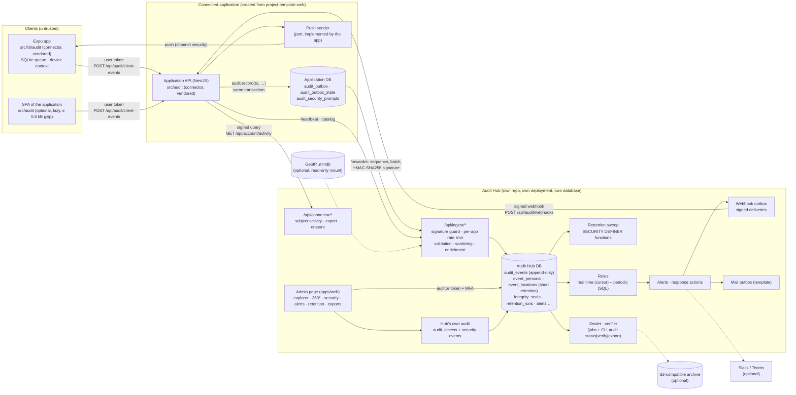
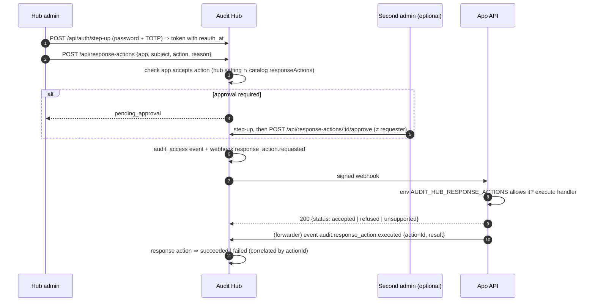
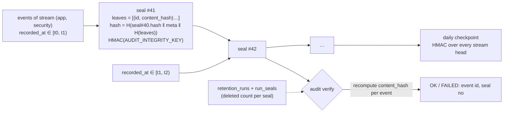

# Audit Hub: components and the journey of an event

Status: **proposal, waiting for approval**. Nothing here is implemented yet. Names of modules and
files are the planned ones.

## Components



Trust boundaries:

- A **device** is never trusted. It talks only to its own backend, with the user's token. It
  holds no Audit Hub secret. Everything it declares is marked `clientDeclared`.
- The **application's API** is trusted for what it observed: actor, IP (`clientIp()` with
  `TRUST_PROXY`), request, outcome. It holds the application's key to Audit Hub, its webhook
  secret and its pseudonymization key.
- **Audit Hub** trusts an application only within its own data. A request signed with app A's key
  can only write to and read from app A. A compromised application cannot alter what it has
  already sent. It also cannot hide a gap in its sequence, because Audit Hub sees the missing
  numbers.

## Journey of a server event

```mermaid
sequenceDiagram
  autonumber
  participant U as User
  participant A as App API (service)
  participant C as Connector (src/audit)
  participant DB as App DB
  participant F as Forwarder (worker)
  participant H as Audit Hub /api/ingest/events
  participant HDB as Hub DB
  participant S as Sealer / rules

  U->>A: PATCH /api/... (business change)
  A->>DB: BEGIN
  A->>DB: SELECT … (explicit select): state BEFORE
  A->>DB: UPDATE … (the change)
  A->>C: audit.record(tx, {action, actor, resource, before, after})
  C->>C: diff, mask sensitive fields, HMAC email/session,<br/>request context (requestId, traceId, clientIp, UA, X-App-*)
  C->>DB: INSERT audit_outbox (event_id = UUIDv7, source_seq = NULL)
  A->>DB: COMMIT (rollback ⇒ no event)
  Note over F: every 2 s, and after a local commit
  F->>DB: BEGIN; lock audit_outbox_state; assign source_seq N+1..N+k<br/>to unsequenced rows (commit order); COMMIT
  F->>DB: claim batch (lease, FOR UPDATE SKIP LOCKED)
  F->>H: POST batch + Audit-Key-Id/Timestamp/Nonce/Signature
  H->>H: verify signature, window, nonce; per-app rate limit
  H->>H: per event: schema, catalog, sanitize/truncate, enrich (geo, UA)
  H->>HDB: INSERT events + satellite rows (one tx, transaction_timeout 10 s)<br/>trigger sets recorded_at = now()
  H-->>F: 200 results: accepted | duplicate | rejected(reason, retryable)
  F->>DB: DELETE accepted, duplicate and non-retryable rejected rows<br/>(rejections logged by id + metric)
  Note over S: horizon = now() − 2 min (no ingest tx can still commit before it)
  S->>HDB: seal window [prev.to, horizon) per (app, category): leaves, hash chain, HMAC
  S->>HDB: rules cursor: new device / country, impossible travel, …
```

When Audit Hub is down, rows stay in `audit_outbox`. The forwarder backs off with jitter and
honors `Retry-After`. The gauges `app_audit_outbox_waiting` and
`app_audit_outbox_oldest_age_seconds` grow, and the alert `ApiAuditBacklog` fires. When Audit Hub
is back, the same rows are sent again with the same `event_id` and `source_seq`. Anything Audit
Hub had already stored answers `duplicate`, so nothing is lost and nothing is duplicated.

## Journey of a client event (app or SPA)

```mermaid
sequenceDiagram
  autonumber
  participant D as Device (connector core)
  participant Q as SQLite queue (per user)
  participant T as Transport (src/api, app's api client)
  participant A as App API /api/audit/client-events
  participant O as audit_outbox

  D->>D: event_id = UUIDv7 (expo-crypto), occurredAt, device context,<br/>location only with consent, rounded to 0.01°
  D->>Q: INSERT (user_ref, event_id, payload) — offline OK
  Note over Q: flush on reconnect, on foreground, every 30 s
  Q->>T: batch ≤ 50 of this user's rows, ordered by occurredAt
  T->>A: POST + Bearer token + X-Request-Id, X-App-Version, X-App-Build, X-Device-Id
  A->>A: action must be in catalog with source client|both
  A->>A: actor := token user, network.ip := clientIp(req),<br/>network.userAgent := header, clientDeclared += [occurredAt, client, location, details]
  A->>O: INSERT … ON CONFLICT (event_id) DO NOTHING
  A-->>T: 200 per event: accepted | duplicate | rejected
  T-->>Q: delete accepted/duplicate/rejected; keep retryable (backoff)
```

At sign-out the app calls `audit.beforeSignOut()`, which flushes for up to 3 seconds with the
user's token. Rows still queued are then deleted. They are never sent with the next user's
session, and their count is reported in the next batch as `discardedAtSignOut`.

## "Was it you?" from end to end

```mermaid
sequenceDiagram
  autonumber
  participant P as Phone (new device)
  participant A as App API
  participant H as Audit Hub
  participant R as Rules (real time)
  participant W as Webhook outbox
  participant P2 as Phone (owner's device)

  P->>A: POST /api/auth/sign-in (new X-Device-Id)
  A->>A: audit.record(tx, auth.session.signed_in) with device, IP
  A->>H: (forwarder) batch
  R->>R: actor_devices has no such device ⇒ signal new_device<br/>(+ new_country / impossible_travel when they apply)
  R->>H: alert (grouped) + suspicious sign-in for this subject
  H->>W: enqueue security.sign_in_suspicious
  W->>A: POST /api/audit/webhooks (signed, delivery id)
  A->>A: verify signature + timestamp, dedupe delivery id
  A->>A: handler: INSERT audit_security_prompts; push port →<br/>Expo push, Android channel "security", data.url = /security/prompts/:id
  A-->>W: 200 accepted
  P2->>P2: tap ⇒ toInternalPath() ⇒ screen (never acts by itself)
  P2->>A: POST /api/account/security-prompts/:id/answer {answer: "not_me"}
  A->>A: tx: revoke all sessions + security_version++ +<br/>audit.record(account.security_prompt.answered, denied)
  A-->>P2: 200
  P->>A: next request with old access token
  A-->>P: 401 (security version moved)
```

## Response action requested by an Audit Hub admin



## Integrity: windows, seals and verification



The ADRs explain the choices in detail: [0008](../../adr/0008-seal-the-audit-log-in-time-windows.md) covers
windows, late commits and retention, and [0007](../../adr/0007-make-audit-tables-append-only-with-retention-in-the-database.md)
covers append-only storage.

## Where each requirement of the brief lands

| Requirement                                   | Where                                                                                                         |
| --------------------------------------------- | ------------------------------------------------------------------------------------------------------------- |
| Stored XSS (1)                                | React text only (ESLint already bans `dangerouslySetInnerHTML`), strict CSP, XSS payload specs on every field |
| Spoofable IP, lost events (2)                 | `clientIp()` + `TRUST_PROXY` in the connector; lenient per-field sanitizing; outbox + seq + gap alert         |
| Unscheduled cleanup (3)                       | jobs + `app_job_last_success_timestamp_seconds` + "job not run" alerts                                        |
| Editable / deletable records (4, 5)           | REVOKE + trigger + `SECURITY DEFINER` purge with minimums and legal holds (ADR 0007)                          |
| "Before" read after the change (6)            | connector reads `before` in the caller's transaction (explicit select), computes the diff                     |
| Session id in clear (7)                       | only `sessionRef` = HMAC (per-app key)                                                                        |
| Invented HTTP status (8)                      | `request.status` set from the response by the connector, never typed by the caller                            |
| Few actions, empty fields (9)                 | typed catalog, validated at publish and at ingest; base catalog of every template flow                        |
| One query per chart point, no pagination (10) | SQL aggregations (one query per chart), cursor pagination, query-count specs                                  |
